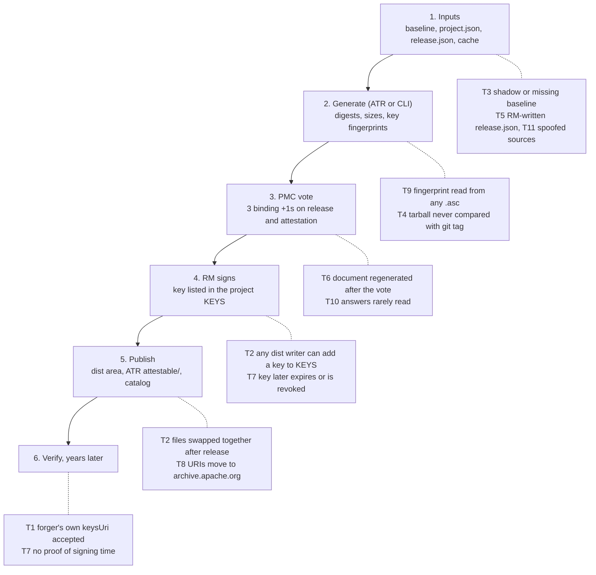

# ASF CRA Attestation Threat Model (Draft)

**Status:** Draft for discussion, 2026-10-21. Reviewed against `main` at commit 55698ae (process v0.3, the
`vsa` package and `vsa/collect`, the ASF baseline, and baseline inheritance from PR #3). Scope is the Tier 1
VSA-lite attestation only. Mitigations M2, M8, M9, M13 and the tool parts of M12 and M14 are implemented in
the same change that adds this file; the rest need ATR, Infra or ASF policy work (see
[Mitigations and roadmap](#mitigations-and-roadmap)).

## Summary

Before this change, an ASF attestation could be forged or swapped by anyone who controls one `KEYS` entry,
because nothing tied the document to an ASF-held record that outlives the PMC's own files. The design is sound
in shape (ASF as issuer, PMC vote, digests of every artifact), but its trust rests on three things a single
insider or an outsider can change: the project's `KEYS` file, the files in the dist area, and the settings
files the tool reads.

The five risks that matter most, in order:

1. **Forged attestation that looks official (outsider).** The document names its own `keysUri`, and
   `vsa verify` reported "valid" without checking any signature. A forger who writes
   `issuer: The Apache Software Foundation` and points `keysUri` at their own site passed the tool's checks.
   *Fixed in the tool:* `vsa verify` now checks every OpenPGP signature, and takes keys only from a local file
   or a trusted apache.org prefix.
2. **Post-release swap (insider).** A committer with dist write access can replace an artifact, its `.asc`,
   its `.sha512`, the SBOM and the attestation together, after adding their own key to `KEYS`. Every file stays
   self-consistent, so a later verifier cannot tell. Needs the required countersignature (M1) and the ASF log
   (M6).
3. **Baseline bypass (insider, confirmed).** A `project.json` can name a fake `asf.json` placed next to it, or
   name no parent at all, and the ASF `required` fields no longer apply. A shadow baseline changed the issuer
   website and set VM.02 to not applicable with no error. *Fixed in the tool:* `vsa generate --root-sha512`
   and `settings.check_root` refuse any root but the published baseline.
4. **What voters see is not what is signed.** The process regenerated the attestation with the vote-pass date
   after the vote, so the signed document differed from the draft that was voted on. *Fixed in the process:*
   the vote approves exact bytes (section 4 of the process), and `vsa diff` prints their SHA-512 and every
   changed answer for the vote email.
5. **Long-term verification fails quietly.** Release manager keys expire or are revoked, `KEYS` files are
   edited, releases move from downloads.apache.org to archive.apache.org, and OpenPGP signature times are
   self-asserted. Years later a verifier cannot show the signature was made before a revocation. The CRA limits
   how long releases must be supported, so verification only has to work for as long as the CRA requires
   (Shane, 2026-10-21), but that is still many years. *Partly fixed in the tool:* `vsa verify` falls back to
   archive.apache.org by digest; timestamps (M5) and the log (M6) remain.

## Open process questions for the ASF

These are outside the scope of the `vsa` tool, and need people from the Tooling team, Infra, Security or the
Board to answer. Shane coordinates them on dev@tooling.apache.org.

1. **Is our use of source control for `KEYS` sufficient?** Probably yes; the ASF has done this for years, and
   committers review changes to `KEYS` files. Decide whether any CRA-specific control is needed on top, such as
   the change alert in M7.
2. **What does ATR already do to permanently secure and authenticate the releases it produces?** If ATR's
   storage and sealing already give an immutable, signed record, the attestation log (M6) should reuse it
   rather than add a second mechanism.
3. **How does ATR guard against a bad actor in a PMC altering CRA answers?** However unlikely that sounds, the
   integration should assume it: ATR controls how and when `vsa` is called, which settings root it passes, and
   what the vote email shows.
4. **Primary record: an ASF hash-chained log, or a public transparency log?** A log written by ATR keeps
   everything on ASF infrastructure. A public transparency log (Rekor or SCITT) is independent of the ASF but
   adds an outside dependency. This needs other human input.
5. **How long must attestations stay verifiable?** The CRA's support-period rules set the minimum. The answer
   fixes how long countersign keys, `KEYS` snapshots, timestamps and the log must be kept.
6. **What should AU.02 publish by default: the chair's name, or only the role?** The tool lets each PMC choose
   (`attestation.contactStyle`: `name` or `role`) and defaults to `name`. A name is clearer for a market
   surveillance authority today, but it goes stale when the chair changes and puts a person's name in a
   long-lived legal record. The role and private@ list stay correct for the life of the attestation. VP Legal
   should say which is the default, and whether a PMC may override it.
7. **Which time should `issued` record?** The process now fixes `issued` when the vote opens, so the PMC votes
   on the exact bytes that are published and nothing changes after the vote. The alternative is the time the
   vote passes or the release is published, which matches when the ASF actually makes the statement, but means
   the attestation is regenerated after the vote and voters never see the final document. Because `issued` is
   part of the attestation ID, the choice also decides when the ID is known. The ASF should confirm which time
   carries legal meaning under the CRA.

## Scope, assets and trust boundaries

| Asset | Why it matters | Who can change it today |
| --- | --- | --- |
| Attestation JSON (and its in-toto wrapper) | The legal statement made in the ASF's name | RM (signs), ATR (stores), any PMC committer with dist write |
| Release artifacts, `.asc`, `.sha512` | What the attestation's digests point at | RM, any PMC committer with dist write |
| SBOM | QA.01 evidence; bound by digest only when listed in `subject.sboms` | RM, dist writers |
| Project `KEYS` file | The trust anchor for every release manager signature | Any PMC member or committer with dist write |
| `baseline/asf.json` and community baselines | Foundation-level answers and `required` locks | Tool repository committers; anyone who can place a file the tool finds first |
| `project.json`, `release-X.json` | Per-project and per-release answers | PMC (through ATR or the project repository); RM for release inputs |
| Collector cache and data sources (projects.json, committees.json, DOAP, GitHub mirror, dist listings) | Pre-filled answers, chair name, commit ID | DOAP and comdev committers, the GitHub mirror, anyone with write access to the cache directory |
| ATR `attestable/` storage and release catalog | Proposed immutable record and index | ATR admins, Tooling team |
| Foundation countersignature key | One key that says "issued by the ASF" | ASF Infra (HSM), ATR signing step |

No single control spans the whole flow: each stage trusts the one before it, and before this change the
verifier at the end trusted whatever `KEYS` file the document pointed to.

**Assumptions.** apache.org DNS and TLS are trustworthy at the time of verification. ASF Infra and ATR admins
are trusted but can make mistakes. Release managers and committers are trusted until shown otherwise, and any
one of them can be compromised. `KEYS` file management already has controls around it, since trusted ASF
committers review source control changes to any `KEYS` file (Shane, 2026-10-21). A verifier may be a
manufacturer, a market surveillance authority or a court, possibly many years after the release, and may have
no contact with the ASF.

## Threats at a glance

Sixteen threats. Likelihood is for the next few years of ASF practice; impact is for a CRA reader relying on
the attestation. Mitigation IDs are defined in [Mitigations and roadmap](#mitigations-and-roadmap).

| ID | Threat | Actor | Likelihood | Impact | Mitigations |
| --- | --- | --- | --- | --- | --- |
| T1 | Forged attestation for a modified release, `issuer` set to the ASF, `keysUri` pointing at the forger's site | External | High | High | M1, M2, M3, M5 |
| T2 | Post-release swap of artifact + `.asc` + `.sha512` + SBOM + attestation, after adding a key to `KEYS` | Insider committer | Medium | High | M1, M4, M6, M7 |
| T3 | Shadow or missing parent baseline removes ASF `required` locks (reproduced) | Insider PMC member | Medium | High | M8, M9 |
| T4 | Compromised RM ships a source tarball that differs from the voted git tag (xz-style) | Insider RM | Low | Critical | M10, M11 |
| T5 | RM edits release inputs: extra artifact in the dist directory, `supersedes` naming another release, misleading `comment` | Insider RM | Medium | Medium | M11, M12 |
| T6 | Signed attestation differs from the voted draft (regenerated after the vote) | Process gap | Certain | Medium | M12 |
| T7 | RM key expired, revoked or removed from `KEYS`; signature time unprovable years later | Time | High | High | M4, M5, M6 |
| T8 | Release URIs break after moving from downloads to archive; `verify` cannot fetch | Time | Certain | Medium | M6, M13 |
| T9 | `.asc` from another file or release copied in; the tool records its fingerprint without checking it signs anything | Insider RM or error | Medium | Medium | M2 |
| T10 | False control answers (for example QA.07 "met" under commit-then-review) published in the ASF's name | PMC, negligent or deliberate | Medium | High | M12, M14 |
| T11 | Spoofed or stale data sources: DOAP, committees.json, `--projects-base`, GitHub mirror, poisoned collector cache | Insider or upstream | Medium | Medium | M9, M10 |
| T12 | Countersign key misuse or compromise; withdrawal notice forged | Insider Infra or ATR, external | Low | Critical | M1, M4, M5 |
| T13 | Lookalike issuer ("Apache Foundation", typosquat domain) on a third-party rebuild | External | Medium | Medium | M3, M5 |
| T14 | Named chair harassed or pressured; personal data kept for years | Social | Medium | Medium | M14 |
| T15 | Social engineering of RM or chair ("an authority needs a re-issued attestation today") | External | Medium | High | M12, M14 |
| T16 | Opt-out used to avoid work on a commercially used project | PMC | Medium | Medium | M14 |

## The three named attack vectors

Each of the three succeeded because the only proof of origin was a key the PMC itself controls, published in a
file the PMC itself can edit.

### 1. Compromised release manager subverting the release

**What they can do.**

- Build the source tarball on their own machine with content that is not in the git tag. The attestation
  records the tag and commit from `release.json` and the tarball's SHA-512, but nothing checks that one
  matches the other.
- Drop an extra file into the dist directory before `vsa-collect release` runs. The collector attests every
  matching file in the listing, so the extra file gains an attestation.
- Write `supersedes`, `validUntil` or `comment` in `release.json`, so that the attestation "supersedes"
  another release, or carries free text that reads as a legal statement by the ASF.
- Sign a document voters never saw, because Finish regenerated it with the vote-pass date.
- Rely on voters not reading the attestation: a +1 on the release counts as a +1 on the attestation.

**What limits it.** Three binding +1 votes, ATR's signature and checksum checks, and public mailing list
archives. These catch carelessness, not a careful attacker.

**Mitigations.** ATR, not the RM, writes `release.json` from its own records (M11). ATR compares the source
tarball to the git tag tree at compose time (M10). The vote email carries the SHA-512 of the exact
attestation and every changed answer, from `vsa diff` (M12, done in the tool). `vsa generate` refuses a
`supersedes` naming the attestation itself, and the schema caps `comment` at 500 characters, which `vsa diff`
shows to voters word for word (M12, done); ATR checks that `supersedes` names a logged attestation of the same
project (M12, ATR part).

### 2. Committer replacing source, SBOM or attestation after release

**What they can do.** Any committer with write access to the project's dist area can add their own key to
`KEYS`, then replace the artifact, its `.asc` and `.sha512`, the SBOM and the attestation in one commit. The
new set is self-consistent: `vsa verify` and `gpg --verify` both pass against the current `KEYS`. The
attestation ID does not help, because it is a UUIDv5 of project URL, version and `issued`, so a forger
computes the same ID.

**What limits it.** Subversion history on dist, review of `KEYS` changes by other committers, mirrors, Maven
Central (which forbids overwriting), and ATR's `attestable/` copy. None of these is checked by a verifier.

**Mitigations.** The foundation countersignature, now required (process section 5), means a swap needs a
second key held by Infra (M1). At Finish, ATR appends the attestation's SHA-512, its signature fingerprints and
the `KEYS` file's digest to an ASF-held, append-only log (M6). A verifier checks the log entry, not just the
files beside the release. A dist change monitor alerts the PMC private list and Security when an existing
release file or a `KEYS` entry changes (M7).

### 3. Outsider forging a future release and attestation

**What they can do.** Take an ASF source release, modify it, write an attestation with the ASF as issuer and
their own `keysUri` and fingerprint, sign it, and host it on a lookalike domain. The schema accepts any HTTPS
`keysUri`.

**What limits it now.** `vsa verify` checks every signature with rpgp-py, and refuses a `keysUri` outside
downloads.apache.org, archive.apache.org/dist and dist.apache.org/repos/dist/release unless the verifier
passes `--keys` or `--trust-prefix` themselves. A forged attestation fails with "KEYS URL not under a trusted
prefix" before anything is downloaded.

**Further mitigations.** A signed trust-anchor file at a fixed apache.org URL (countersign key history,
allowed `KEYS` prefixes, log URL) that `verify` reads instead of its built-in prefixes (M3). The definitive
answer to "is this the ASF's attestation" is a lookup of its digest in the ASF log, which a forger cannot
write to (M6), and the foundation countersignature (M1). Publish both rules in a verification guide.

## Long-term verifiability

A verifier years from now needs three facts: these bytes were issued by the ASF, they were issued on or before
a date, and the key was good at that date. How long this must hold is set by the CRA's support periods (open
question 5).

| Problem | What happens today | Fix |
| --- | --- | --- |
| RM key expires or is revoked | `gpg --verify` fails or warns, and nothing shows the signature predates the revocation; OpenPGP creation time is set by the signer | RFC 3161 timestamp over each signature from a public TSA, stored beside it, or a Rekor entry with its inclusion proof (M5) |
| Key removed from `KEYS`, or `KEYS` rewritten | The current `KEYS` no longer holds the key; old copies live only in Subversion history | Record the SHA-512 of `KEYS` at Finish in the log, and archive that exact copy in `attestable/` (M4, M6). `vsa verify --keys` already accepts an archived copy |
| Releases move from downloads.apache.org to archive.apache.org | Artifact URIs break | Done: `vsa verify` tries archive.apache.org/dist when downloads.apache.org gives 404, plus any `--mirror OLD=NEW`, and accepts a file only by its digest (M13) |
| Who held the countersign key in a given year? | Rotation every two years is planned, but there is no published key history | A signed key-history file (fingerprint, valid from, valid to, revocation reason) at a fixed URL and in the log (M4) |
| Hash or signature algorithm weakens | SHA-512 is fine for decades; git commit IDs are SHA-1 | Allow adding digests later through a superseding entry in the log; record the git tree's SHA-256 when the repository supports it |
| ATR or the catalog is retired | The `attestable/` store is one service | Publish the log as plain files, mirrored to archive.apache.org; any copy can be checked against the signed log head (M6) |
| Attestation withdrawn | A withdrawal notice in the catalog, format not defined, unsigned | A signed withdrawal entry in the same log, so a forged or hidden withdrawal is detectable (M6) |

**A possible log design (open question 4).** One append-only JSON Lines file per year, one line per event
(issued, countersigned, superseded, withdrawn, key added, key retired). Each line includes the SHA-512 of the
previous line, so editing any past line breaks every later hash. ATR signs the head with the countersign key
once a day, and the head digest goes into an RFC 3161 timestamp. Writing and checking it is plain,
deterministic Python using rfc8785 for canonical JSON, the same choice ATR made in `sealing.py`.

## Findings in the code and docs

Paths are relative to `format/` at commit 55698ae.

| Severity | Where | Finding | Status |
| --- | --- | --- | --- |
| High | `vsa/settings.py` `find` | A parent is looked up next to the child file before any `-I` directory, so a `project.json` naming `asf.json` gets a copy planted beside it; a file with no `parent` gets no locks at all | Fixed: `settings.check_root` and `vsa generate --root-sha512` (M8). Without the flag, `generate` warns |
| High | `vsa/cli.py`, `vsa/digests.py` | `vsa verify` said "valid" after checking only schema and digests, then deferred to `gpg` and the KEYS file the document names | Fixed: `vsa/verify.py` and `vsa/keyring.py` check every signature with rpgp-py against `--keys` or a trusted prefix (M2) |
| High | `vsa/signature.py` | The fingerprint is read from any `.asc` without checking that it signs the artifact | Fixed when ATR or the RM passes keys: `vsa generate --keys` and `assemble.attestation(ring=...)` verify each signature (M2) |
| High | Process section 2 vs schema | The process said the attestation records the digests of its input files; it did not | Fixed: schema 0.4.0 `inputs` lists each settings file, root first, and the release file, with SHA-512 (M9) |
| Medium | `vsa/assemble.py` | `validUntil`, `supersedes` and `comment` are copied from `release.json` unchecked | Partly fixed: self-supersede refused, `comment` capped at 500 characters and shown by `vsa diff`; ATR writes these fields (M11, M12) |
| Medium | `vsa/assemble.py` `_attestation_id` | `attestationId` is a UUIDv5 of public values, so a forger computes the real ID | Open: the log should use the SHA-512 of the document as its identity (M6) |
| Medium | `vsa/intoto.py` | `verify` on an in-toto Statement checked only the predicate | Fixed: `intoto.check` fails when the Statement subjects differ from `subject.artifacts` |
| Medium | `vsa/collect/fetch.py` | The cache is plain files with no integrity check, and `--offline` replays whatever is there | Fixed: the collector report lists the SHA-512 of every response used, cached or not (M9) |
| Medium | `vsa/collect/fetch.py` `_fetch_ref` | If `refs/tags/X` is missing, the ref is fetched as given, so a branch with the version's name is accepted; tags come from the GitHub mirror | Open: ATR should supply the tag and commit (M10, M11) |
| Medium | `vsa/collect/sources.py` `dist_files` | Every file in the dist listing that matches the version is attested | Open: ATR's own artifact list should be the source (M11) |
| Medium | `vsa/collect/resolve.py` QA.06 | "met" when the PMC roster has 3 or more members, not when the vote had 3 binding +1s | Open: use ATR's vote record (M11) |
| Low | `vsa/digests.py` | `verify` downloaded any HTTPS URI and followed redirects, with no size limit | Fixed: `vsa/https.py` refuses redirects to http or another host, and downloads over 2 GiB (M13) |
| Low | `vsa/signature.py` | A malformed armor block could raise `IndexError`, shown as a traceback (still fails closed) | Fixed: reported as a malformed signature |

**What was already good.** Generation never touches the network, and the same inputs give byte-identical
output. It fails closed on missing answers, rejects MD5 and SHA-1 artifact digests, refuses non-HTTPS
fetches, and holds no keys.

## Legal, social and contributor risks

Every attestation speaks for the ASF, so the people around it become targets, and a false answer becomes the
Foundation's statement. None of this is legal advice; these are risks to raise with VP Legal.

- **False or stale answers in the ASF's name (T10).** A PMC that marks QA.07 or QA.04 "met" when it is not, or
  keeps a year-old profile, puts a misstatement under the ASF's issuer. The 12-month review and the vote help,
  but a +1 on a release is rarely a reading of 19 controls. Mitigation: the vote email lists every answer that
  changed since the last release (`vsa diff`), and ATR blocks the vote when the profile is past review.
- **The named chair (T14).** AU.02 puts a real person's name in a document meant to last for years, beside a
  legal regime. That is personal data that cannot be withdrawn from copies, and it invites direct pressure,
  legal threats or harassment of a volunteer. Mitigation: a PMC can now publish the role and private@ list
  only (`attestation.contactStyle: role`); VP Legal decides the default (open question 6).
- **Social engineering (T15).** Attackers will pose as a market surveillance authority, a CSIRT or a large
  customer and ask an RM or chair to "urgently re-issue" or "correct" an attestation, or to add a key.
  Mitigation: a published rule that attestations are only issued or withdrawn through ATR and the log, never
  by email; requests go to VP Security; the contact address is a list, not a person.
- **A bad actor inside a PMC.** A PMC member could push false `not_met` answers, a misleading `comment`, or a
  withdrawal to harm the project or a downstream company. The same controls apply: changes shown in the vote,
  the settings root fixed by ATR, withdrawals signed and logged with the deciding body named.
- **Opt-out misuse (T16).** A widely used project could opt out to avoid the work, leaving manufacturers with a
  "not assessed" attestation they may misread. Process open question 5 asks whether the Board or VP Security
  can refuse; a usage signal in the board report would help that decision.
- **Countersignature overread.** A court or customer may read the foundation key as an ASF audit. Mitigation:
  the countersignature's meaning is published with the key, and should be carried in the signed data (a fixed
  meaning URI) once the countersign format is defined.
- **Contributor exposure.** RMs may hesitate to sign if they fear personal liability. The process should state
  that the RM signs as an agent of the ASF under the PMC vote; confirm with VP Legal before rollout.
- **Evidence quality in disputes.** If an attestation is used in litigation, the ASF needs to show who
  generated it, from which inputs, and when. The `inputs` block, the log and timestamps give that record with no
  extra manual work.

## Mitigations and roadmap

| ID | Mitigation | Owner | Status |
| --- | --- | --- | --- |
| M2 | `vsa verify` checks OpenPGP signatures with rpgp-py, checks in-toto subjects, never trusts `keysUri` from the document; `vsa generate --keys` checks each `.asc` | Tooling (this repository) | Done |
| M8 | Pin the root baseline by SHA-512 (`--root-sha512`, `settings.check_root`); ATR supplies it | Tooling, then ATR | Done in the tool |
| M9 | `inputs` in the schema with the SHA-512 of every settings file and the release file; response digests in the collector report | Tooling | Done |
| M12 | Vote on exact bytes; `vsa diff` gives their SHA-512 and every changed answer; self-supersede refused; `comment` capped | Tooling + ATR | Tool parts done; ATR checks `supersedes` against the log |
| M13 | `verify` falls back to archive.apache.org and `--mirror` prefixes by digest, caps downloads, refuses cross-host redirects | Tooling | Done |
| M14 | AU.02 role-only option; issue and withdraw only through ATR; published verification guide; opt-out review | Tooling, VP Security, VP Legal | `contactStyle` done; the rest is policy |
| M1 | Foundation countersignature required for every attestation | Board, VP Security, Infra, ATR | Required in process v0.4; needs Board approval and the key |
| M3 | Signed trust-anchor file at a fixed apache.org URL: countersign key history, allowed `KEYS` prefixes, log URL | Infra + Security | Before rollout |
| M6 | ASF append-only attestation log written by ATR at Finish, or a public transparency log (open question 4) | ATR + Infra | Before rollout |
| M11 | ATR writes `release.json` and the artifact list from its own records; QA.06 from the vote record | ATR | Before rollout |
| M10 | ATR compares the source tarball with the git tag tree and records the result; require a real tag | ATR | Before rollout |
| M5 | RFC 3161 timestamp (or Rekor entry) for every RM signature, countersignature and log head | ATR | Before rollout |
| M4 | Archive the exact `KEYS` file used, and publish a signed countersign key history | ATR + Infra | Before rollout |
| M7 | Alert private@ and Security when an existing dist release file or a `KEYS` entry changes | Infra | Later, if open question 1 says it is needed |

ATR integration is itself a mitigation for many of these: ATR is the trusted caller that decides how and when
`vsa` runs, which root baseline and keys it passes, and what voters see (Shane, 2026-10-21).
